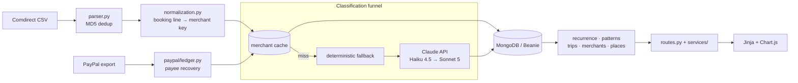

# Personal Finance Dashboard

A self-hosted FastAPI application that turns a Comdirect CSV export into a
categorised ledger and reads the schedules, trips and month-over-month changes
hidden inside it.

[](https://fastapi.tiangolo.com)
[](https://www.mongodb.com)
[](https://python-poetry.org)
[](https://github.com/henrygerlach/Personal-Finance-Dashboard/actions/workflows/ci.yml)


There is no hosted demo, because the input is a bank statement. Two commands
stand the whole app up on an invented one instead:

```bash
mise run seed-demo   # two years of a generated current account
mise run dev-demo    # http://127.0.0.1:8000
```

Every screenshot on this page is of that ledger. No real statement appears here.

## Why I built it

A German bank export is a booking line, an amount and a date. The merchant is
buried in machine text that changes on every visit to the same shop, and payment
processors overwrite it entirely, so *what did I spend on groceries in March* is
not a question a statement answers.

The previous version of this dashboard answered it by hand: 609 substring rules
over 2,676 transactions, and every new merchant meant a 610th rule. This version
deletes the rule library and gives the booking line to a classifier instead, but
puts the API call last, behind a merchant cache and two deterministic recovery
steps, so most transactions never reach it.

## What it does

- **Import.** Comdirect CSV upload, MD5-deduplicated, plus PayPal activity exports.
- **Classify.** Every transaction gets one of 73 minor categories under 14 majors,
  decided by the Claude API and validated against the hierarchy before storage.
- **Review.** Anything the classifier declined to guess queues for a human. Filing
  one by hand writes the merchant cache, so that merchant never costs a call again.
- **Detect.** Recurring payments and their price rises; trips and what each one
  actually cost; which month-over-month differences mean something; which merchants
  a category total is hiding.
- **Drill down.** Every number on every chart opens the transactions behind it.

| | |
|---|---|
| Taxonomy | 14 major × 73 minor categories, one source of truth |
| Tests | 857 cases in about three seconds, 97% line coverage, no database required |
| Code | ~29k lines of Python, plus Jinja templates, JS and CSS |
| Frontend | Server-rendered Jinja + vanilla JS. No build step, no `node_modules` |


*Trips are proposed from the card reporting somewhere that is not home; confirming
one makes membership explicit, so flights bought in March and a friend settling up
in October both count against a July week.*


*The classifier declines rather than guessing. Filing one by hand writes the
merchant cache, so the next payment to that shop costs no API call.*

## Tech stack

| Component | Version | Role |
|---|---|---|
| Python | 3.11 | Runtime, pinned by mise |
| FastAPI | 0.109 | HTTP layer; page routes render Jinja, `/api/*` returns JSON |
| Uvicorn | 0.27 | ASGI server |
| MongoDB | 8 (Docker) | Storage; ten document collections |
| Beanie / Motor | 1.30 / 3.7 | Async ODM and driver |
| Pydantic Settings | 2.13 | Typed configuration from environment and `.env` |
| Anthropic SDK | 1.0 | Classification: Haiku 4.5, escalating to Sonnet 5 |
| pandas | 2.3 | CSV parsing of the Comdirect export |
| Jinja2 | 3.1 | Templates |
| Chart.js | 4.4 (CDN) | Every chart |
| Poetry / mise | — | Dependencies / tasks and environment |
| ruff, pytest, mypy | 0.2, 8.4, 1.19 | Lint and format, tests, type checking |

## How it works



A CSV upload is parsed and deduplicated, then each booking line is reduced to a
merchant key. The funnel answers from the merchant cache first, recovers PayPal
payees second, files unrecoverable PayPal lines deterministically third, and only
then calls the API, once per unknown merchant rather than once per transaction.
Results are written to MongoDB. The detection modules (`patterns`, `trips`,
`recurrence`, `merchants`, `places`) are pure functions over transactions with no
database access of their own; `app/services/` reads for them and `routes.py`
renders.

### What replacing the rules cost

Three things got worse when the rule library went, and each is answered in one
place rather than hoped away.

**A classifier is not deterministic.** The same booking line can come back
differently on two runs. The merchant cache is as much the answer to that as it
is a cost saving: a merchant is decided once and read from the cache afterwards,
so the ledger stops moving underneath the charts. A category filed by hand writes
a `source="user"` entry, which outranks the model permanently.

**Every classification is billable.** The funnel is ordered to ask as little as
possible, and what is left is batched 25 at a time behind a cached system prompt,
four batches in flight. `app/classification/pricing.py` prices a run from the
usage the client reports, because a cache that has quietly stopped hitting looks
exactly like one that hits, except on the invoice.

**A model will answer confidently when it should not.** Every result is checked
against the taxonomy and against a confidence threshold before it is stored.
Anything failing either becomes `Uncategorized / Needs Review` and waits for a
human, rather than becoming a category nobody chose. A batch that errors is
retried three times and then given up on alone; it does not take the rest of the
import down with it.

The rule engine is switched off behind `settings.rules_enabled` rather than
deleted, so the decision stays reversible.

## Getting started

**Prerequisites:** [mise](https://mise.jdx.dev), Docker, and an Anthropic API key.
Python and Poetry are installed by mise itself.

```bash
git clone https://github.com/henrygerlach/Personal-Finance-Dashboard.git
cd Personal-Finance-Dashboard

mise trust          # mise refuses to read an untrusted config
mise install        # Python 3.11 + Poetry
mise run install    # poetry install --all-extras

cp .env.example .env   # then put your key in it

mise run dev        # starts MongoDB, serves http://127.0.0.1:8000
```

Then either upload a Comdirect CSV on `/upload`, or fill the demo database:

```bash
mise run seed-demo  # writes bank_analyzer_demo, and refuses any other name
mise run dev-demo
```

`scripts/seed_demo.py` generates two years of an invented current account from a
fixed seed, built to exercise the detectors: standing charges with price rises and
a cancellation, three stretches abroad in both card formats Comdirect uses, a café
habit drifting up over the last quarter, and a review queue of unclassifiable lines.

`.mise.toml` sets `MONGODB_URL` (port 27018, so it cannot collide with another
project's MongoDB) and `DATABASE_NAME`. Starting `uvicorn` directly without those
points the app at 27017, where nothing is listening. The API key is deliberately
not in that file: `.mise.toml` is in version control and `.env` is not.

<details>
<summary><strong>All tasks, and PayPal exports</strong></summary>

| | |
|---|---|
| `mise run install` | `poetry install --all-extras` |
| `mise run dev` / `mongo` | the dashboard with auto-reload / just the database |
| `mise run test` / `coverage` | pytest / pytest with a per-module coverage report |
| `mise run lint` / `format` | ruff check + format --check / ruff format |
| `mise run backup` | dump the working database before anything that rewrites it |
| `mise run seed-demo` / `dev-demo` | the synthetic ledger the screenshots use |
| `mise run merchants` | how well normalization collapses transactions onto merchants |
| `mise run migrate` | migrate categories to the current taxonomy |
| `mise run backfill` | classify transactions still holding a provisional category |
| `mise run repair-refunds` | re-file transactions whose category disagrees with their direction |
| `mise run migrate-merchant-directions` | give every cache entry the direction it speaks for |
| `mise run eval` | score the classifier against the hand-made categories |
| `mise run import-paypal` | store PayPal activity exports (`-- paypal_data/`) |
| `mise run resolve-paypal` | re-file PayPal lines whose payee the export recovered |

Every script that writes supports `--dry-run`. Run that first. PayPal activity
exports (PayPal → Activity → Download → CSV) go in through `import-paypal` then
`resolve-paypal`; overlapping downloads are deduplicated, and the upload page
accepts the same files.

</details>

<details>
<summary><strong>Start and stop from Spotlight (macOS)</strong></summary>

```bash
./scripts/install-macos-app.sh
```

`cmd+space` → **Personal Finance Dashboard** starts MongoDB and the server and opens the
browser once the page answers; **Stop Personal Finance Dashboard** shuts both down. The
bundles hold only a small compiled stub, because macOS grants Documents-folder
access by the signature of the running process and a shell script would run as
`/bin/bash`. The logic lives in `scripts/launcher.sh` and `scripts/stopper.sh`, so
changes need no reinstall.

</details>

<details>
<summary><strong>The switched-off predecessor</strong></summary>

`app/categorizer.py`, `CATEGORY_HIERARCHY` in `app/constants.py`,
`app/legacy_mapping.py` and the `/categorize` and `/rules` pages are the
hand-written substring rule engine that served 2,676 transactions and 609 rules
before the classifier replaced it. It is switched off behind `settings.rules_enabled`
rather than deleted, so the decision stays reversible, and a comparison log records
both verdicts side by side while it is still in place.

</details>

## Testing and quality

`mise run test` runs 857 cases in about three seconds against no database. The
detection modules are pure functions over transactions and everything below them
is stood in for, which is what keeps the suite that fast; `mise run coverage`
reports 97% line coverage. GitHub Actions runs the same lint, format and test
commands on every push, with no secrets and no service container, so a CI run
cannot cost money.

## Status

Working, and in weekly use against my own Comdirect statements. Statements go in
roughly once a month and this is what I read afterwards.

It is single-user and self-hosted, with no authentication, so it is meant to run
on localhost and nowhere else. Development is occasional rather than finished:
the most recent additions were month-over-month pattern detection and the
merchant concentration page, and the rule engine stays switched off behind its
flag until the comparison log has nothing left to say.

## License

MIT. See [LICENSE](LICENSE).
