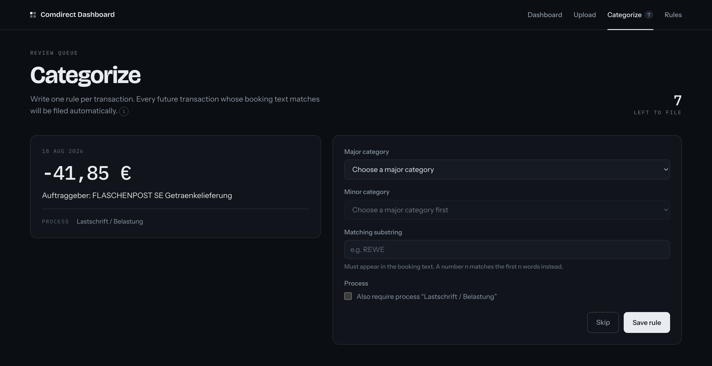
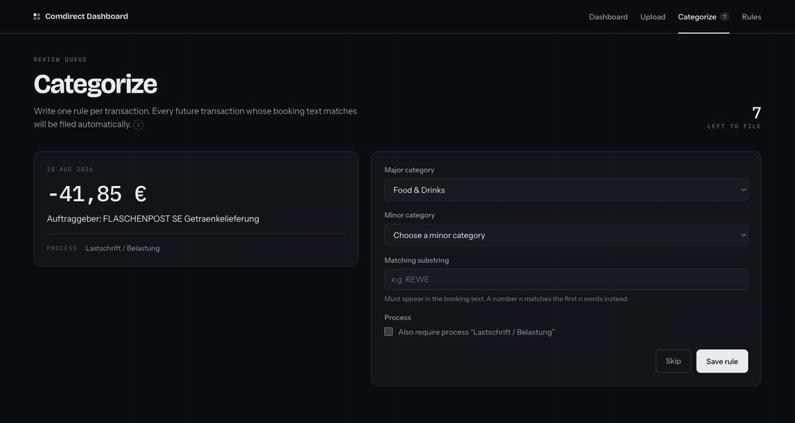
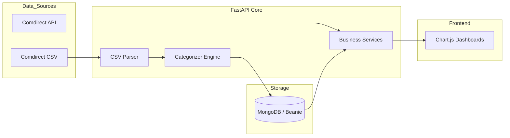

# 🏦 Comdirect Personal Finance Dashboard
**A Fullstack FastAPI & MongoDB Application for Automated Wealth Tracking.**

[](https://fastapi.tiangolo.com)
[](https://www.mongodb.com)
[](https://python-poetry.org)
[](/tests)

> **The Value:** Transforming messy CSV bank exports into actionable financial insights. Featuring a custom rule-based engine for automated transaction categorization.

## 🖼️ Dashboard Preview

*Interactive charts showing spending patterns and net cashflow trends.*

## 🧩 Create Rule Preview

*Rule creation interface for assigning automatic transaction categories. Rules are composed of a substring of the booking text and an optional process.*


*Filing one transaction: pick the categories, enter the substring, optionally pin the process, and save. The queue advances and the new rule lands in the rule library.*

## 🚀 Technical Highlights & "The Hard Stuff"
* **Advanced Categorization Engine:** Implemented a rule-based matching system that evaluates rules in creation order to automate 90% of manual bookkeeping.
* **Data Integrity:** MD5-based hashing for transaction deduplication – ensuring clean data even with overlapping CSV imports.
* **Modern Stack:** Asynchronous database access via **Beanie ODM**, containerized environment with **Docker**, and dependency management with **Mise/Poetry**.
* **PayPal Payee Recovery:** Joins PayPal activity exports to the bank statement on amount, direction and settlement delay, recovering the merchant Comdirect truncates out of its PayPal lines — 96.8% of them, with ties refused rather than guessed.
* **Optional Startup Sync:** On app start, account balances can optionally be fetched from the Comdirect API to refresh balance snapshots.
* **Resilience:** Implemented a fallback mechanism for Comdirect API outages, serving cached balance snapshots from MongoDB.

## 🏗️ System Architecture


## 🚀 Quick Start
This project uses mise for toolchain management, environment and tasks.

```Bash
# 1. Toolchain and dependencies
mise trust          # mise refuses to read an untrusted config
mise install
mise run install

# 2. The API key for classification
echo "ANTHROPIC_API_KEY=sk-ant-..." > .env

# 3. Launch — the database starts with it
mise run dev
```

Visit http://127.0.0.1:8000.

`.mise.toml` sets `MONGODB_URL` and `DATABASE_NAME`. Without it the app falls
back to port 27017 while the container publishes 27018, and dies on the first
query — so start through mise, or export those two yourself.

The API key stays out of `.mise.toml` on purpose: that file is in version
control, `.env` is not.

### Tasks

| | |
|---|---|
| `mise run dev` | the dashboard, with auto-reload |
| `mise run mongo` | just the database |
| `mise run test` / `lint` / `format` | the usual |
| `mise run backup` | dump the working database before anything that rewrites it |
| `mise run merchants` | how well normalization collapses transactions onto merchants |
| `mise run migrate` | migrate categories to the new taxonomy (`-- --dry-run` to preview) |
| `mise run backfill` | classify transactions still holding a provisional category |
| `mise run repair-refunds` | re-file transactions whose category disagrees with their direction |
| `mise run migrate-merchant-directions` | give every merchant cache entry the direction it speaks for (`-- --dry-run`) |
| `mise run eval` | score the classifier against the hand-made categories |
| `mise run import-paypal` | store PayPal activity exports (`-- paypal_data/`) |
| `mise run resolve-paypal` | re-file PayPal lines whose payee the export recovered (`-- --dry-run`) |

## 💸 PayPal: putting the missing payee back

Comdirect truncates the merchant out of many PayPal debits, leaving lines like
`PP.5189.PP . , Ihr Ei nkauf bei Ref. ...` — a payment with no payee. Nothing
in that string identifies a merchant, so the pipeline used to file them all
under one placeholder category.

A PayPal activity export knows who was paid. Importing one lets the classifier
put the payee back, after which the line is an ordinary merchant line and goes
through the ordinary funnel — cache, classifier, correction in the UI.

```Bash
# PayPal -> Activity -> Download -> CSV, one year at a time (the export caps
# the range). Either language works; overlapping downloads are deduplicated.
mise run import-paypal -- paypal_data/

# Transactions already in the database, re-filed with the payee restored.
mise run resolve-paypal -- --dry-run
mise run resolve-paypal
```

The upload page accepts PayPal exports too — they are recognised by their
header and routed to the ledger instead of the statement parser, so both kinds
of CSV go through the same control.

**How the join works.** Nothing links the two sides by identity: the reference
Comdirect prints is a SEPA mandate, and the export has no column carrying it.
So a bank line is matched to the PayPal *settlement* — the row that moves money
between PayPal and the bank — on amount to the cent, direction, and a booking
delay of nought to five days, which is one-sided because the bank never books
before PayPal pulls. The settlement itself names nobody; the payee is found by
following its `related_code` back to the payment, twice over when a refund sits
in between.

**Pay in 30 days.** Deferred payment breaks that chain: PayPal pays the shop
at the till, so nothing reaches the bank at the time, and collects a month
later. The collection is what the bank sees, and it names *PayPal* rather than
the shop and points at nothing. PayPal is never accepted as a payee — it is
the processor between the two parties — so where the pointer is missing the
ledger matches the settled amount against the balance movements around it and
follows that to the shop instead. The same shape covers a refund that was
withdrawn to the bank without a pointer joining the two rows. This is thinner
evidence than a pointer, so it is used only in its absence and flagged as
`linked_by_amount` on the settlement.

Ties are refused rather than guessed. Two people paid ten euros each in the
same week produce two candidates and no way to choose, so the line keeps the
fallback category and stays visible as unresolved.

On the dataset this was built against, 150 of 155 truncated lines (96.8%)
recovered their payee. Most turned out not to be shopping at all but payments
to friends and family, which moved €3,406 of outflow out of the spending
totals and into transfers.

## 🍏 Start & Stop from Spotlight (macOS)
Install two small app bundles once:

```Bash
./scripts/install-macos-app.sh
```

Afterwards `cmd+space` → **Comdirect Dashboard** starts MongoDB and the server and opens
the browser once the page really answers; **Stop Comdirect Dashboard** shuts both down
again — the container is only stopped, never removed, so all transactions and rules stay.

The bundles only contain a stub; the logic lives in `scripts/launcher.sh` and
`scripts/stopper.sh`, so changes take effect without reinstalling. Both write to
`~/Library/Logs/Comdirect-Dashboard.log`.

> The project lives in the Documents folder, which macOS protects, so both bundles
> need permission for it — without it they cannot even read their own scripts. Their
> stub is therefore a small compiled binary (built by the install script, which needs
> the Xcode command line tools): macOS decides about folder access by the signature of
> the running process, and a shell script as the bundle's executable would run as
> `/bin/bash` — a system binary the granted permission never matches, so the app would
> be denied silently and do nothing at all.
>
> Should an app still report missing access, add it under *System Settings → Privacy &
> Security → Full Disk Access*, or let macOS ask again:
>
> ```Bash
> tccutil reset SystemPolicyDocumentsFolder local.comdirect.dashboard
> tccutil reset SystemPolicyDocumentsFolder local.comdirect.stopper
> ```
