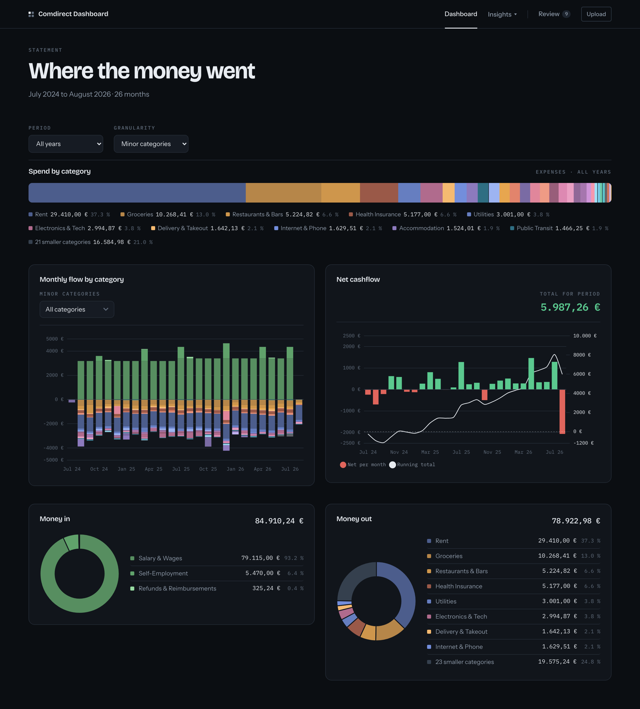
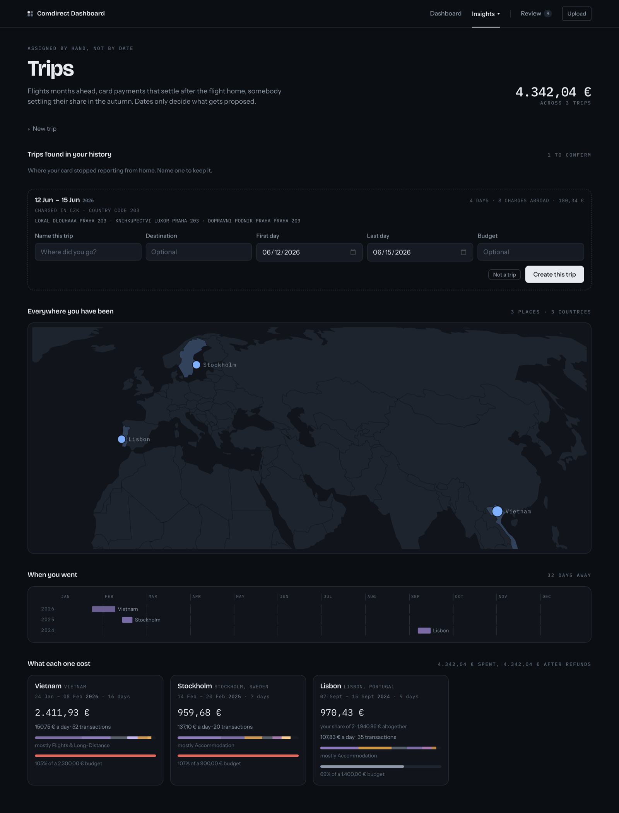
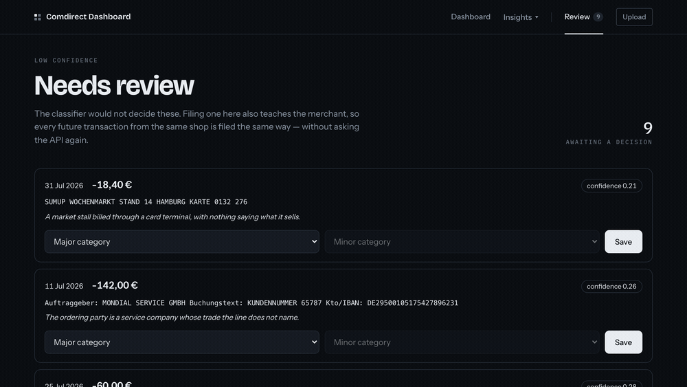
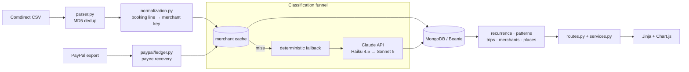

# Personal Finance Dashboard

A self-hosted FastAPI application that turns a Comdirect CSV export into a
categorised ledger and reads the schedules, trips and month-over-month changes
hidden inside it.

[](https://fastapi.tiangolo.com)
[](https://www.mongodb.com)
[](https://python-poetry.org)
[](https://github.com/henrygerlach/Personal-Finance-Dashboard/actions/workflows/ci.yml)

German bank exports are a booking line, an amount and a date. The merchant is
buried in machine text that varies on every visit to the same shop, and payment
processors overwrite it entirely. The previous version of this dashboard handled
that with 609 hand-written substring rules over 2,676 transactions, and each new
merchant meant another rule. This version replaces the rule library with a
classifier, but puts the API call last, behind a merchant cache and two
deterministic recovery steps, so most transactions never reach it.



> In weekly use against my own Comdirect statements, which is why every
> screenshot here is of a synthetic ledger generated by
> `scripts/seed_demo.py`. No real statement appears on this page.

---

## What it does

- **Import.** Comdirect CSV upload, MD5-deduplicated, plus PayPal activity exports.
- **Classify.** Every transaction gets one of 73 minor categories under 14 majors,
  decided by the Claude API and validated against the hierarchy before storage.
- **Review.** Anything the classifier declined to guess queues for a human. Filing
  one by hand writes the merchant cache, so that merchant never costs a call again.
- **Detect.** Recurring payments and their price rises; trips and what each one
  actually cost; which month-over-month differences mean something; which merchants
  a category total is hiding.
- **Drill down.** Every number on every chart opens the transactions behind it.

| | |
|---|---|
| Taxonomy | 14 major × 73 minor categories, one source of truth |
| Tests | 840 cases, 2.2 s, 97% coverage, no database required |
| Code | ~34k lines across `app/`, `scripts/` and `tests/` |
| Frontend | Server-rendered Jinja + vanilla JS. No build step, no `node_modules` |



*Trips are proposed from the card reporting somewhere that is not home; confirming
one makes membership explicit, so flights bought in March and a friend settling up
in October both count against a July week.*



*The classifier declines rather than guessing. Filing one by hand writes the
merchant cache, so the next payment to that shop costs no API call.*

## Tech stack

| Component | Version | Role |
|---|---|---|
| Python | 3.11 | Runtime, pinned by mise |
| FastAPI | 0.109 | HTTP layer; page routes render Jinja, `/api/*` returns JSON |
| Uvicorn | 0.27 | ASGI server |
| MongoDB | 8 (Docker) | Storage; ten document collections |
| Beanie / Motor | 1.30 / 3.7 | Async ODM and driver |
| Pydantic Settings | 2.13 | Typed configuration from environment and `.env` |
| Anthropic SDK | 1.0 | Classification: Haiku 4.5, escalating to Sonnet 5 |
| pandas | 2.3 | CSV parsing of the Comdirect export |
| Jinja2 | 3.1 | Templates |
| Chart.js | 4.4 (CDN) | Every chart |
| Poetry / mise | — | Dependencies / tasks and environment |
| ruff, pytest, mypy | 0.2, 8.4, 1.19 | Lint and format, tests, type checking |

## Architecture



A CSV upload is parsed and deduplicated, then each booking line is reduced to a
merchant key. The funnel answers from the merchant cache first, recovers PayPal
payees second, files unrecoverable PayPal lines deterministically third, and only
then calls the API, once per unknown merchant rather than once per transaction. Results
are written to MongoDB. The detection modules (`patterns`, `trips`, `recurrence`,
`merchants`, `places`) are pure functions over transactions with no database
access of their own; `services.py` reads for them and `routes.py` renders.

## Getting started

**Prerequisites:** [mise](https://mise.jdx.dev), Docker, and an Anthropic API key.
Python and Poetry are installed by mise itself.

```bash
git clone <repo-url> && cd Personal-Finance-Dashboard

mise trust          # mise refuses to read an untrusted config
mise install        # Python 3.11 + Poetry
mise run install    # poetry install --all-extras

echo "ANTHROPIC_API_KEY=sk-ant-..." > .env

mise run dev        # starts MongoDB, serves http://127.0.0.1:8000
```

`.mise.toml` sets `MONGODB_URL` (port 27018, so it cannot collide with another
project's MongoDB) and `DATABASE_NAME`. Starting `uvicorn` directly without those
points the app at 27017, where nothing is listening. The API key is deliberately
not in that file: `.mise.toml` is in version control and `.env` is not.

To see the app with data, without a bank statement:

```bash
mise run seed-demo  # writes bank_analyzer_demo, and refuses any other name
mise run dev-demo
```

`scripts/seed_demo.py` generates two years of an invented current account from a
fixed seed, built to exercise the detectors: standing charges with price rises and a
cancellation, three stretches abroad in both card formats Comdirect uses, a café
habit drifting up over the last quarter, and a review queue of unclassifiable lines.

<details>
<summary><strong>All tasks, and PayPal exports</strong></summary>

| | |
|---|---|
| `mise run dev` / `mongo` | the dashboard with auto-reload / just the database |
| `mise run test` / `coverage` | pytest / pytest with a per-module coverage report |
| `mise run lint` / `format` | ruff check + format --check / ruff format |
| `mise run backup` | dump the working database before anything that rewrites it |
| `mise run seed-demo` / `dev-demo` | the synthetic ledger the screenshots use |
| `mise run merchants` | how well normalization collapses transactions onto merchants |
| `mise run migrate` | migrate categories to the current taxonomy |
| `mise run backfill` | classify transactions still holding a provisional category |
| `mise run repair-refunds` | re-file transactions whose category disagrees with their direction |
| `mise run migrate-merchant-directions` | give every cache entry the direction it speaks for |
| `mise run eval` | score the classifier against the hand-made categories |
| `mise run import-paypal` | store PayPal activity exports (`-- paypal_data/`) |
| `mise run resolve-paypal` | re-file PayPal lines whose payee the export recovered |

Every script that writes supports `--dry-run`. Run that first. PayPal activity
exports (PayPal → Activity → Download → CSV) go in through `import-paypal` then
`resolve-paypal`; overlapping downloads are deduplicated, and the upload page
accepts the same files.

</details>

<details>
<summary><strong>Start and stop from Spotlight (macOS)</strong></summary>

```bash
./scripts/install-macos-app.sh
```

`cmd+space` → **Personal Finance Dashboard** starts MongoDB and the server and opens the
browser once the page answers; **Stop Personal Finance Dashboard** shuts both down. The
bundles hold only a small compiled stub, because macOS grants Documents-folder
access by the signature of the running process and a shell script would run as
`/bin/bash`. The logic lives in `scripts/launcher.sh` and `scripts/stopper.sh`, so
changes need no reinstall.

</details>

<details>
<summary><strong>The switched-off predecessor</strong></summary>

`app/categorizer.py`, `CATEGORY_HIERARCHY` in `app/constants.py`,
`app/legacy_mapping.py` and the `/categorize` and `/rules` pages are the
hand-written substring rule engine that served 2,676 transactions and 609 rules
before the classifier replaced it. It is switched off behind `settings.rules_enabled`
rather than deleted, so the decision stays reversible, and a comparison log records
both verdicts side by side while it is still in place.

</details>

## Testing and quality

`mise run test` runs 840 cases in 2.2 seconds against no database, and
`mise run coverage` reports 97% line coverage, with no module below 93%.

## License

MIT. See [LICENSE](LICENSE).
