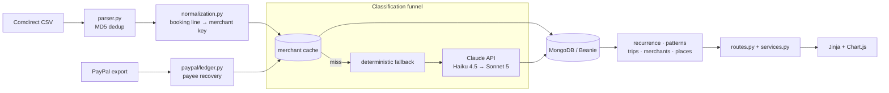

# Comdirect Dashboard

A self-hosted FastAPI application that turns a Comdirect CSV export into a
categorised ledger and reads the schedules, trips and month-over-month changes
hidden inside it.

[](https://github.com/henrygerlach/comdirect-dashboard/actions/workflows/ci.yml)

German bank exports are a booking line, an amount and a date. The merchant is
buried in machine text that varies on every visit to the same shop, and payment
processors overwrite it entirely. The previous version of this dashboard handled
that with 609 hand-written substring rules over 2,676 transactions, and each new
merchant meant another rule. This version replaces the rule library with a
classifier — but puts the API call last, behind a merchant cache and two
deterministic recovery steps, so most transactions never reach it.


> Every screenshot here is of a synthetic ledger generated by
> `scripts/seed_demo.py`. No real statement appears on this page.

---

## What it does

- **Import.** Comdirect CSV upload, MD5-deduplicated, plus PayPal activity exports.
- **Classify.** Every transaction gets one of 73 minor categories under 14 majors,
  decided by the Claude API and validated against the hierarchy before storage.
- **Review.** Anything the classifier declined to guess queues for a human. Filing
  one by hand writes the merchant cache, so that merchant never costs a call again.
- **Detect.** Recurring payments and their price rises; trips and what each one
  actually cost; which month-over-month differences mean something; which merchants
  a category total is hiding.
- **Drill down.** Every number on every chart opens the transactions behind it.

| | |
|---|---|
| Taxonomy | 14 major × 73 minor categories, one source of truth |
| Tests | 840 cases, 2.2 s, 97% coverage, no database required |
| Code | ~34k lines across `app/`, `scripts/` and `tests/` |
| Frontend | Server-rendered Jinja + vanilla JS. No build step, no `node_modules` |


*Trips are proposed from the card reporting somewhere that is not home; confirming
one makes membership explicit, so flights bought in March and a friend settling up
in October both count against a July week.*


*The classifier declines rather than guessing. Filing one by hand writes the
merchant cache, so the next payment to that shop costs no API call.*

## Tech stack

| Component | Version | Role |
|---|---|---|
| Python | 3.11 | Runtime, pinned by mise |
| FastAPI | 0.109 | HTTP layer — page routes render Jinja, `/api/*` returns JSON |
| Uvicorn | 0.27 | ASGI server |
| MongoDB | 8 (Docker) | Storage; ten document collections |
| Beanie / Motor | 1.30 / 3.7 | Async ODM and driver |
| Pydantic Settings | 2.13 | Typed configuration from environment and `.env` |
| Anthropic SDK | 1.0 | Classification — Haiku 4.5, escalating to Sonnet 5 |
| pandas | 2.3 | CSV parsing of the Comdirect export |
| Jinja2 | 3.1 | Templates |
| Chart.js | 4.4 (CDN) | Every chart |
| Poetry / mise | — | Dependencies / tasks and environment |
| ruff, pytest, mypy | 0.2, 8.4, 1.19 | Lint and format, tests, type checking |

## Architecture



A CSV upload is parsed and deduplicated, then each booking line is reduced to a
merchant key. The funnel answers from the merchant cache first, recovers PayPal
payees second, files unrecoverable PayPal lines deterministically third, and only
then calls the API — once per unknown merchant, not once per transaction. Results
are written to MongoDB. The detection modules (`patterns`, `trips`, `recurrence`,
`merchants`, `places`) are pure functions over transactions with no database
access of their own; `services.py` reads for them and `routes.py` renders.

## Key engineering decisions

**The API is the last step of the funnel, not the first.** Every transaction is
reduced to a merchant, merchants repeated within a batch are collapsed onto one,
and only merchants nobody has seen are sent on — so a monthly import of 150
transactions becomes a handful of merchants and one request. The group key is
merchant *and direction*, because one answer is fanned out across the group and a
merchant produces both signs: a purchase at Amazon and the refund for it. Grouping
on the merchant alone let the first transaction's sign decide for the rest, which
filed outgoing payments as refunds. Only the merchants that genuinely run both ways
cost a second request. *Rejected:* one call per transaction, which is simpler, and
both slower and more expensive by the ratio of transactions to distinct merchants.

**Two models, and the arithmetic to prove the cheap one is enough.** Haiku 4.5
classifies; anything below the 0.7 confidence threshold is escalated to Sonnet 5 in
a separate pass, so its cost and its effect stay visible rather than hidden inside
a retry. The constant part of the prompt — instructions, hierarchy, worked examples
— sits in a cache-breakpointed system block and everything that varies goes after
it; adding a timestamp to that block would silently defeat the arrangement.
`pricing.py` carries a dated price table with the cache read/write multipliers, and
`last_usage` exposes what the API reported, because a cache that stops hitting
looks exactly like one that hits, except on the invoice. *Rejected:* a single
strong model everywhere, and trusting caching works without measuring it.

**Detection proposes; the user decides.** Nothing the app infers is created or
named automatically — a detected schedule or trip is offered as a blank proposal to
confirm. Confirmed decisions live in their own collections (`RecurringOverride`,
`TripAssignment`, `DismissedTripProposal`, `PatternDismissal`), not as fields on
`Transaction`, because transactions are rewritten by re-import, re-classification
and the repair scripts, and a person's decision must not sit in that blast radius.
Each is keyed on the facts that identify the thing — merchant + period + amount,
the anchor transaction — never on a recomputed id, since findings are rebuilt on
every page load. *Rejected:* denormalising the decision onto the transaction, which
is one collection fewer and loses the decision on the next import.

**Robust statistics, and thresholds that are shares rather than euros.** The
month-over-month detectors use medians and median absolute deviation, never means:
a real ledger contains holidays and tax bills, and each of those moves a mean far
enough to hide everything else — including itself. Every absolute test is a
fraction of that ledger's own median month, so the same constants behave the same
way for someone spending ten times as much. And the trailing month is dropped until
its statement lands, because comparing a four-day month against a full one reports
a spending collapse every time. *Rejected:* means and fixed-euro floors, which are
thresholds tuned to exactly one person's dataset.

**Recovering the payee Comdirect throws away.** Many PayPal debits arrive as
`PP.5189.PP . , Ihr Ei nkauf bei Ref. …` with no payee at all. Nothing links the
bank line to the PayPal export by identity — the reference Comdirect prints is a
SEPA mandate, and the export has no column carrying it — so the join is amount,
direction and a one-sided booking lag, after which the payee is followed back
through `related_code`. Deferred payment ("Pay in 30 days") breaks that pointer, so
the ledger falls back to matching the settled amount against nearby balance
movements and flags it as weaker evidence. Genuine ties return no match rather than
a guess. On the statement it was built against it recovered 150 of 155 truncated
lines. *Rejected:* fuzzy string matching, and accepting the nearest candidate.

Free-text trip destinations resolve the same way — offline, against an 800 KB
Natural Earth gazetteer committed to the repo rather than a geocoding API. This
application reads bank statements; handing a third party the list of places its
user has been on holiday, for a coordinate that has not moved since the eighteenth
century, is a bad trade.

## Getting started

**Prerequisites:** [mise](https://mise.jdx.dev), Docker, and an Anthropic API key.
Python and Poetry are installed by mise itself.

```bash
git clone <repo-url> && cd comdirect-dashboard

mise trust          # mise refuses to read an untrusted config
mise install        # Python 3.11 + Poetry
mise run install    # poetry install --all-extras

echo "ANTHROPIC_API_KEY=sk-ant-..." > .env

mise run dev        # starts MongoDB, serves http://127.0.0.1:8000
```

`.mise.toml` sets `MONGODB_URL` (port 27018, so it cannot collide with another
project's MongoDB) and `DATABASE_NAME`. Starting `uvicorn` directly without those
points the app at 27017, where nothing is listening. The API key is deliberately
not in that file: `.mise.toml` is in version control and `.env` is not.

To see the app with data, without a bank statement:

```bash
mise run seed-demo  # writes bank_analyzer_demo, and refuses any other name
mise run dev-demo
```

`scripts/seed_demo.py` generates two years of an invented current account from a
fixed seed, built to exercise the detectors: standing charges with price rises and a
cancellation, three stretches abroad in both card formats Comdirect uses, a café
habit drifting up over the last quarter, and a review queue of unclassifiable lines.

<details>
<summary><strong>All tasks, and PayPal exports</strong></summary>

| | |
|---|---|
| `mise run dev` / `mongo` | the dashboard with auto-reload / just the database |
| `mise run test` / `coverage` | pytest / pytest with a per-module coverage report |
| `mise run lint` / `format` | ruff check + format --check / ruff format |
| `mise run backup` | dump the working database before anything that rewrites it |
| `mise run seed-demo` / `dev-demo` | the synthetic ledger the screenshots use |
| `mise run merchants` | how well normalization collapses transactions onto merchants |
| `mise run migrate` | migrate categories to the current taxonomy |
| `mise run backfill` | classify transactions still holding a provisional category |
| `mise run repair-refunds` | re-file transactions whose category disagrees with their direction |
| `mise run migrate-merchant-directions` | give every cache entry the direction it speaks for |
| `mise run eval` | score the classifier against the hand-made categories |
| `mise run import-paypal` | store PayPal activity exports (`-- paypal_data/`) |
| `mise run resolve-paypal` | re-file PayPal lines whose payee the export recovered |

Every script that writes supports `--dry-run`. Run that first. PayPal activity
exports (PayPal → Activity → Download → CSV) go in through `import-paypal` then
`resolve-paypal`; overlapping downloads are deduplicated, and the upload page
accepts the same files.

</details>

<details>
<summary><strong>Start and stop from Spotlight (macOS)</strong></summary>

```bash
./scripts/install-macos-app.sh
```

`cmd+space` → **Comdirect Dashboard** starts MongoDB and the server and opens the
browser once the page answers; **Stop Comdirect Dashboard** shuts both down. The
bundles hold only a small compiled stub, because macOS grants Documents-folder
access by the signature of the running process and a shell script would run as
`/bin/bash`. The logic lives in `scripts/launcher.sh` and `scripts/stopper.sh`, so
changes need no reinstall.

</details>

<details>
<summary><strong>The switched-off predecessor</strong></summary>

`app/categorizer.py`, `CATEGORY_HIERARCHY` in `app/constants.py`,
`app/legacy_mapping.py` and the `/categorize` and `/rules` pages are the
hand-written substring rule engine that served 2,676 transactions and 609 rules
before the classifier replaced it. It is switched off behind `settings.rules_enabled`
rather than deleted, so the decision stays reversible — and a comparison log records
both verdicts side by side while it is still in place.

</details>

## Testing and quality

`mise run test` runs **840 cases in 2.2 seconds against no database**, and
`mise run coverage` reports **97% line coverage**, with no module below 93%.

Nothing in the suite touches MongoDB. The detection modules are pure functions
over transactions, so they take `SimpleNamespace` stand-ins directly; the
service and route layers get `tests/fixtures/odm.py`, an in-memory stand-in for
the Beanie documents in which a field comparison builds a predicate and `find`
applies it. The API client is driven by a fake that replays scripted responses
and failures, and the routes run against a bare app with no lifespan. `tests/`
mirrors the modules, test names are sentences describing the behaviour, and the
docstring says why the case matters — usually by naming the bug that would
otherwise be silent. `tests/fixtures/booking_texts.py` holds real booking lines,
including the seven line-wrap variants of one PayPal phrase that cost 164
merchants in the first version of the normalizer.

`mise run eval` scores the classifier against 2,253 hand-categorised transactions
with the merchant cache switched off, on a seeded sample, and reports how many
sampled merchants also appear in the prompt's worked examples — because those have
been handed the answer and inflate the score by exactly that much.

`.github/workflows/ci.yml` runs `ruff check`, `ruff format --check` and the
suite on every push and pull request. It needs no service container and no
credentials of any kind: the tests reach neither MongoDB nor the Claude API,
and the one private dependency — the optional Comdirect API client — is an
extra that a plain `poetry install` skips. So a run costs nothing, holds no
secret to rotate, and cannot be flaky for any of those reasons.

Stated plainly, what does not exist: coverage is measured but not enforced, so
nothing fails a build for dropping it. mypy is a dependency but is not wired
into any task, so type hints are documentation rather than a gate. The
uncovered 3% is mostly defensive branches and the third-party Comdirect glue.

## Roadmap

- Make mypy a blocking check in CI rather than an unused dependency.
- Move the backfill script onto the Message Batches API, which halves every token
  price for work that has no latency requirement.
- Fail the CI build below a coverage floor, so the 97% cannot quietly regress.
- Support more than one account in the same database, which the models currently
  assume away.
- Replace the CDN Chart.js tag with a vendored copy, so the app works offline.

## License

MIT — see [LICENSE](LICENSE).

Not affiliated with comdirect bank AG.
