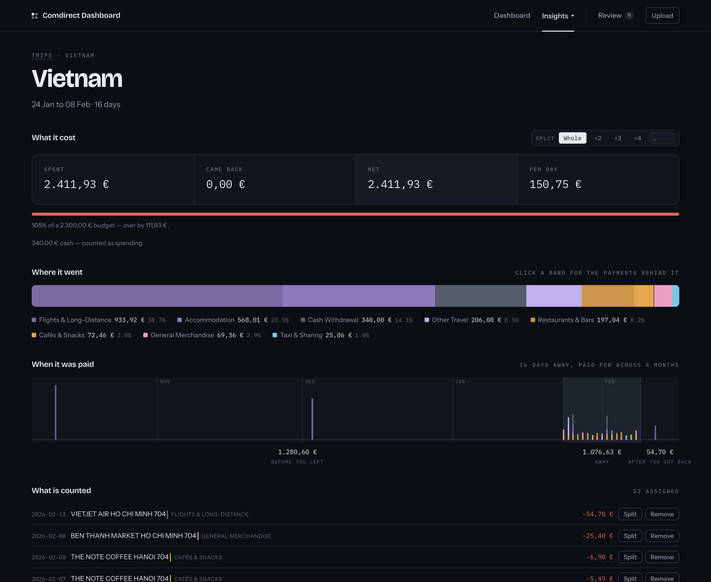
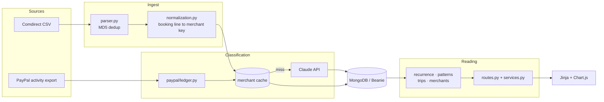

# Comdirect Personal Finance Dashboard

**A monthly bank statement, read properly.** Upload the CSV your bank exports,
and get back a categorised ledger, the schedules hiding inside it, what changed
since last month, and what each holiday actually cost.

[](https://fastapi.tiangolo.com)
[](https://www.mongodb.com)
[](https://docs.anthropic.com)
[](/tests)


Categorisation is done by the Claude API against a fixed 14 × 73 taxonomy, not
by hand-written string rules — but the API is the last step of the funnel, and
most transactions never reach it.

> Every screenshot here is of a synthetic ledger built by
> `scripts/seed_demo.py`. No real statement appears on this page.

---

## Trips

The dates of a holiday do not contain its spending: flights are bought months
ahead, the last night abroad reaches the bank a week after the flight home, and
somebody settles their half of the house in October. So the app only watches
for the card reporting from somewhere that is not home, and proposes the window.


Confirming one creates the trip; from then on membership is explicit, and the
three windows around the dates only decide what gets offered. Cash withdrawn
abroad counts as spending here even though it is a transfer everywhere else —
what it turned into never reaches the bank.



## Review

The classifier declines rather than guessing. Filing one by hand also writes the
merchant cache, so the next payment to that shop never costs an API call.


---

## The parts worth reading

**The funnel is ordered on purpose.** Merchant cache → PayPal payee recovery →
a deterministic fallback for lines holding no merchant → the API for the rest. A
`source="user"` entry outranks the model permanently, and every API result is
checked against the hierarchy and a confidence threshold before it is stored.

**Recovering the payee Comdirect throws away.** Many PayPal debits arrive as
`PP.5189.PP . , Ihr Ei nkauf bei Ref. …`, with no payee in them. Nothing links
the two sides by identity, so a bank line is matched to the PayPal settlement on
amount, direction and a one-sided booking lag, then the payee is followed back
through `related_code`. Ties are refused rather than guessed; it recovered 150
of 155 truncated lines on the ledger it was built against.

**Detection proposes, the user decides.** Hand-made decisions live in their own
collections, not as fields on `Transaction`, because transactions get rewritten
by re-import and the repair scripts. Each is keyed on the facts that identify
the thing — merchant + period + amount, the anchor transaction — never on an id,
because findings are recomputed on every page load.

**Robust statistics.** The month-over-month detectors use medians and MAD, never
means, or the holidays raise the bar meant to catch them. Thresholds are shares
of that ledger's own median month, and the trailing month is dropped until its
statement lands.

**The map does not phone home.** Free-text destinations resolve against an
800 KB Natural Earth gazetteer in the repo, rather than handing a third party
the list of places its user has been on holiday.

**One taxonomy.** `app/categories.py` is the only place a category list may
exist, and `flow_type` is derived from the major category rather than stored, so
transfers cannot leak into an expense total.

**523 tests in 0.7 seconds, no database.** The detection modules are pure
functions, so the suite stands documents up with `SimpleNamespace`.

## Architecture



<details>
<summary><strong>Running it</strong></summary>

Everything goes through [mise](https://mise.jdx.dev), which also sets
`MONGODB_URL` and `DATABASE_NAME`. Starting `uvicorn` without those two points
the app at port 27017, where nothing is listening.

```bash
mise trust          # mise refuses to read an untrusted config
mise install
mise run install

echo "ANTHROPIC_API_KEY=sk-ant-..." > .env

mise run dev        # http://127.0.0.1:8000, starts MongoDB with it
```

The key stays out of `.mise.toml`: that file is in version control, `.env` is not.

| | |
|---|---|
| `mise run dev` | the dashboard, with auto-reload |
| `mise run mongo` | just the database |
| `mise run test` / `lint` / `format` | the usual |
| `mise run backup` | dump the working database before anything that rewrites it |
| `mise run seed-demo` / `dev-demo` | the synthetic ledger the screenshots use |
| `mise run merchants` | how well normalization collapses transactions onto merchants |
| `mise run migrate` | migrate categories to the current taxonomy |
| `mise run backfill` | classify transactions still holding a provisional category |
| `mise run repair-refunds` | re-file transactions whose category disagrees with their direction |
| `mise run migrate-merchant-directions` | give every cache entry the direction it speaks for |
| `mise run eval` | score the classifier against the hand-made categories |
| `mise run import-paypal` | store PayPal activity exports (`-- paypal_data/`) |
| `mise run resolve-paypal` | re-file PayPal lines whose payee the export recovered |

Every script that writes supports `--dry-run`. Run that first.

</details>

<details>
<summary><strong>The screenshots</strong></summary>

```bash
mise run seed-demo   # writes bank_analyzer_demo, and only that
mise run dev-demo
```

`scripts/seed_demo.py` generates two years of an invented current account from a
fixed seed, and refuses to run against any database whose name does not end in
`_demo` — it drops every collection it touches, and the other two databases in
the container hold real statements.

The ledger is built to exercise the detectors: standing charges with price rises
and a cancellation, three stretches abroad in both of the card formats Comdirect
uses, a utility settlement, a café habit drifting up over the last quarter, and
a review queue of lines that hold nothing to classify.

</details>

<details>
<summary><strong>PayPal exports</strong></summary>

```bash
mise run import-paypal -- paypal_data/   # PayPal -> Activity -> Download -> CSV
mise run resolve-paypal -- --dry-run
mise run resolve-paypal
```

Overlapping downloads are deduplicated, and the upload page accepts these files
too. Deferred payment ("Pay in 30 days") breaks the pointer the join follows, so
the ledger falls back to matching the settled amount against the balance
movements around it and flags that as `linked_by_amount`.

</details>

<details>
<summary><strong>Start and stop from Spotlight (macOS)</strong></summary>

```bash
./scripts/install-macos-app.sh
```

`cmd+space` → **Comdirect Dashboard** starts MongoDB and the server and opens the
browser once the page answers; **Stop Comdirect Dashboard** shuts both down. The
container is stopped, never removed.

The bundles hold only a stub — a small compiled binary, because macOS grants
Documents-folder access by the signature of the running process and a shell
script would run as `/bin/bash`. The logic lives in `scripts/launcher.sh` and
`scripts/stopper.sh`, so changes need no reinstall. If access is refused:

```bash
tccutil reset SystemPolicyDocumentsFolder local.comdirect.dashboard
tccutil reset SystemPolicyDocumentsFolder local.comdirect.stopper
```

</details>

<details>
<summary><strong>The switched-off predecessor</strong></summary>

`app/categorizer.py`, `CATEGORY_HIERARCHY` in `app/constants.py`,
`app/legacy_mapping.py` and the `/categorize` and `/rules` pages are a
hand-written substring rule engine that served 2,676 transactions and 609 rules
before the classifier replaced it. It is switched off behind
`settings.rules_enabled` rather than deleted, so the decision stays reversible.

</details>
